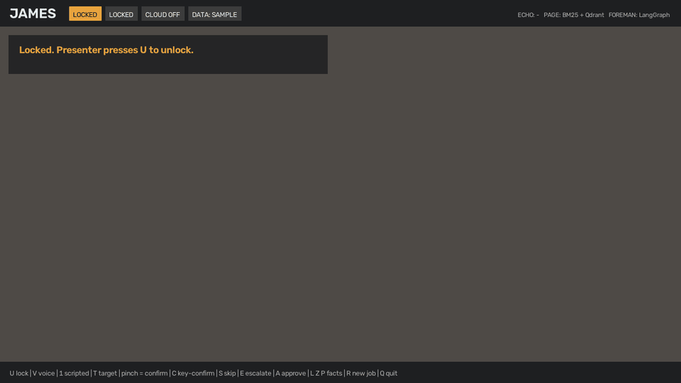
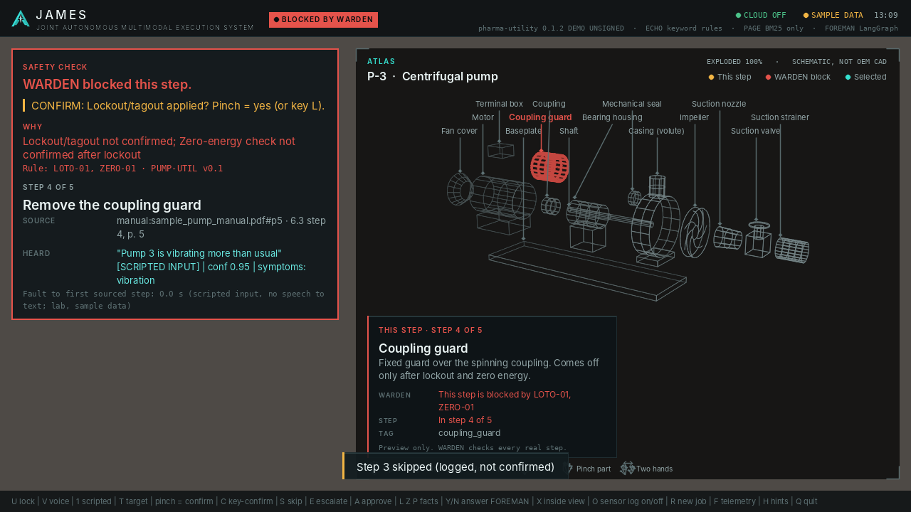
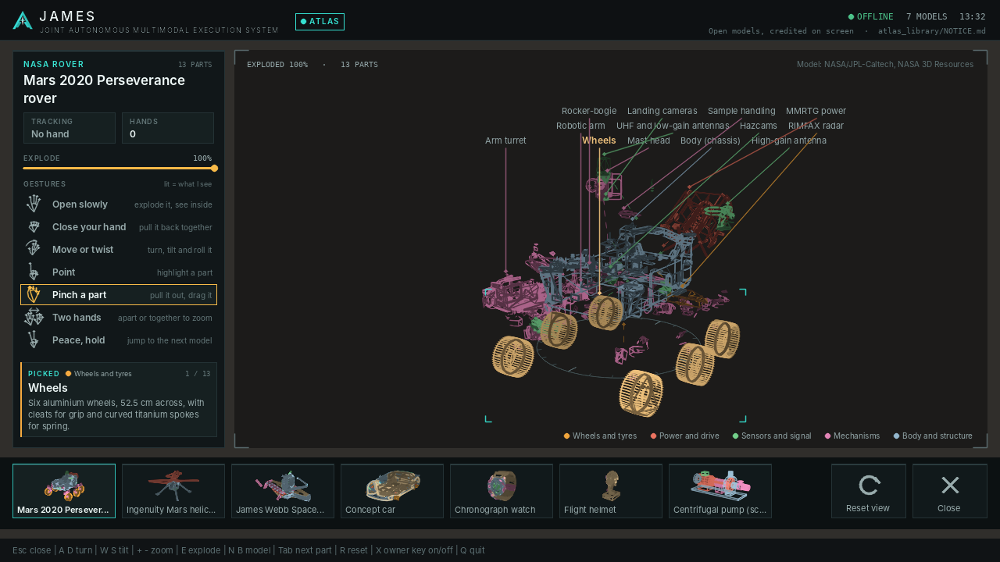
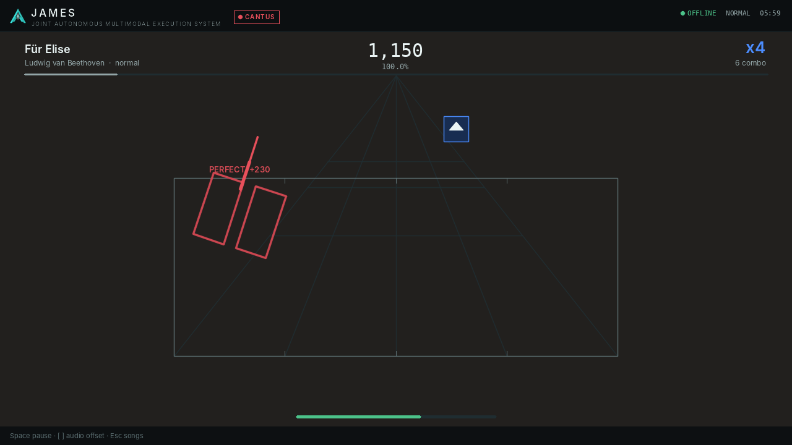

<p align="center">
  
</p>

# JAMES

JAMES (Joint Autonomous Multimodal Execution System) is a touch-free maintenance copilot for macOS. A technician
with gloves on and both hands busy can't scroll a PDF manual, so JAMES watches the camera and listens instead.
You point at the machine and say what is wrong; it finds the procedure, checks the sensor log and past repairs,
and walks you through the fix one step at a time. Each step needs a pinch to confirm, and a rule engine with no
AI in it refuses unsafe steps. Everything runs on the laptop.

Site: [jamesagent.vercel.app](https://jamesagent.vercel.app/)

> [!NOTE]
> This is a demo build. It ships with sample data and demo safety rules (PUMP-UTIL v0.1). They are not approved
> for any real plant, and nothing here is certified for safety use.

<p align="center">
  
  <br>
  <sub>Real app screens from rehearsal mode (<code>python app.py --sim</code>): lock, target the pump, sourced steps, a safety block, the fix, and a second run that recalls the approved job.</sub>
</p>

## How it works

<p align="center">
  
</p>

LENS reads your hand and the ArUco asset tag on the machine. ECHO turns speech into a request. FOREMAN sends it
to PAGE (the manual), PULSE (the sensor log) and LEDGER (past jobs) in parallel, then decides the likely cause.
Every step comes from the manual with a page citation, and readings come from the supplied log. If the evidence
is weak it says so, and if the sources can't separate two causes it asks you one question from the manual's table.

When a senior approves a finished repair, the next similar request recalls it first; unapproved jobs aren't
recalled. The top bar shows which backend is live (model or keyword rules, BM25 or BM25 + Qdrant).

Machines aren't hard-coded. Rules, faults, sensors, manuals and asset tags live in an industry pack, and the app
refuses to start if a pack file changed after its manifest was hashed (format in [`PACK_FORMAT.md`](PACK_FORMAT.md)).

| Agent | Job | Where | Stack |
|---|---|---|---|
| LENS | Sees hands and the asset tag | `agents/lens.py` | MediaPipe Hand Landmarker, OpenCV ArUco |
| ECHO | Hears the request | `agents/echo.py` | sounddevice, faster-whisper `base.en`, Qwen3-VL 4B via Ollama (keyword rules if offline) |
| PAGE | Finds the procedure | `agents/page.py` | PyMuPDF, BM25, nomic-embed-text in Qdrant (in-process); re-queries when weak; cites pages |
| PULSE | Reads the sensor log | `agents/pulse.py` | pandas on the supplied log |
| LEDGER | Remembers approved jobs | `agents/recall.py`, `james_core/ledger.py` | SQLite, append-only, hash-chained |
| FOREMAN | Plans and decides the cause | `agents/foreman.py` | LangGraph fan-out to PAGE, PULSE, LEDGER; local model or source vote |
| WARDEN | Blocks unsafe steps | `james_core/safety_guard.py` | Plain Python + the pack's rules |
| Pinch gate | Confirms each step | `app.py`, `james_core/session.py` | Pinch and hold 600 ms on the current, unexpired, allowed step |

### The safety gate

<p align="center">
  
</p>

WARDEN is plain Python plus the pack's rule file. The model can suggest a step, but only WARDEN can let it
through, and only a pinch on the current, unexpired, allowed step moves the job forward.

A pinch that starts as a closing fist doesn't count, and neither does one where the hand moves toward or away
from the camera while held (usually someone reaching for a tool). SIGHT warns when tracking can't be trusted (low
light, dark gloves, a hand that keeps dropping out). Every logged event is hash-chained, and
`python -m tools.verify_ledger` names the first edited or removed one. Details in `docs/ITERATIONS.md`,
iteration 10.

`python -m james_core.suite` prints the seeded safety result: 8/8 violations blocked, 0/4 false blocks.

## ATLAS: the exploded view

<p align="center">
  
</p>

Press X and JAMES draws the targeted machine as an exploded schematic in the free part of the camera view. The
part the current step touches is amber when WARDEN allows the step and red when WARDEN is blocking it. Pinch any
part to see what it does and which rules guard it.

The colour comes from the same hazard tags WARDEN uses (`coupling_guard`, `bearing_housing`...) plus the part's
own words in the manual step, not from a model. The drawing ships in the pack (`models/<class>.yaml`) and is
labelled on screen as a schematic, not OEM CAD.

While ATLAS is open it owns the hand (open slowly to explode, close to assemble, move or twist to turn, point to
light a part, two hands to zoom), so a pinch there can't confirm a step. Close it with X first. Each pick is
logged with the time since ATLAS opened (`atlas_part_selected`), so "time to find the part" can be measured.

### The ATLAS app

ATLAS is also an app in the everyday assistant's launcher (the ATLAS tile, or say "open atlas"), or on its own
with `python atlas_app.py`. A shelf at the bottom holds seven models.

<p align="center">
  
</p>

The models are Perseverance, Ingenuity and the James Webb Space Telescope (NASA 3D Resources, public domain), a
concept car and a chronograph (Khronos glTF Sample Assets, CC BY 4.0), a flight helmet (Khronos, CC0) and the
pack's centrifugal pump. `tools/atlas_import.py` converted them once into line drawings in `atlas_library/`,
which the app reads with NumPy and hash-checks against `atlas_library/library.yaml`. Credits are on screen and in
[`atlas_library/NOTICE.md`](atlas_library/NOTICE.md). JAMES is not endorsed by NASA, Khronos or any model
author, and no textures or logos are used.

## CANTUS: a rhythm game

The CANTUS tile in the launcher, or `python cantus.py` on its own. Blocks fly towards you and
reach the frame on the beat; swing through each one the way its arrow points, red with your left hand and blue
with your right. Timing gives PERFECT, GOOD or OK, and hits in a row raise the multiplier up to x8.

<p align="center">
  
</p>

Four public-domain pieces are built in (Ode to Joy, Für Elise, Canon in D, Turkish March), synthesised in
`james_core/cantus_songs.py`. For your own songs, drop an MP3, M4A or WAV into `data/cantus/songs/` and press R;
`james_core/beatmap.py` finds the tempo and onsets (spectral flux and autocorrelation, no model) and builds the
maps once. `data/cantus/` is git-ignored, so your files stay on your Mac.

## Setup

```bash
git clone https://github.com/victorisaacchinta-eng/james.git
cd james
bash setup.sh
```

`setup.sh` makes a virtual environment, installs everything, downloads the speech model and runs the tests. It
should end with `630 passed, 1 skipped` (the `tests/` folder; the skip needs the neural voice files),
`PACK CHECK: PASS` and `RESULT: PASS`. `python -m pytest -q` also runs the Lab's tests in `lab/tests`.

If [Ollama](https://ollama.com) is installed, setup also pulls `qwen3-vl:4b` and `nomic-embed-text`. Without it,
JAMES still runs on keyword rules and BM25 search, and says so on screen.

The neural voice (Kokoro-82M) is optional: its files are 348 MB, too big for GitHub, so
`python -m tools.get_voice` fetches them from the
[kokoro-onnx release `model-files-v1.1`](https://github.com/thewh1teagle/kokoro-onnx/releases/tag/model-files-v1.1)
into `assets/voice/` and checks pinned sha256 hashes. Without them JAMES uses the macOS `say` voice.

`JAMES_PACK=<pack-id>` picks a different industry pack (default `pharma-utility`), and
`JAMES_GOOGLE_ACCOUNT=you@example.com` makes the Gmail, Drive and Calendar links open that account. Everything
else is in `config.py`; raise `PINCH_RATIO` if gloves make pinching hard.

## Run

```bash
source .venv/bin/activate
python app.py              # maintenance copilot: camera + microphone
python app.py --no-voice   # camera only; key 1 sends the request
python app.py --sim        # rehearsal: no camera or mic, saves every screen to data/sim_frames/
python james.py            # everyday assistant: gestures, voice, app launcher (with ATLAS and CANTUS)
python atlas_app.py        # ATLAS on its own
python cantus.py           # CANTUS on its own
```

macOS asks for Camera and Microphone access for Terminal the first time; allow both and run again. Click the
JAMES window once so it gets key presses. For a live demo, print `assets/asset_tag_P-3.pdf` at 100% and stick it
on the "pump" (or show `asset_tag_P-3.png` full screen on a phone), and start the model with `ollama serve`.

The 90-second demo script (unlock, point at P-3, ask about vibration, skip lockout to trigger the WARDEN block,
open ATLAS, confirm lockout and zero energy, finish, approve, rerun to see the recall) is in
[`USER_MANUAL.md`](USER_MANUAL.md). If the mic fails, key 1 sends the scripted request, labelled [SCRIPTED
INPUT] on screen. If the pinch fails with gloves, key C confirms, logged as `key_fallback`.

### Everyday assistant (`python james.py`)

Open palm for the launcher, point and pinch to open an app. Hold a V sign to start listening, keep holding while
you talk, and close your hand into a fist to run the command ("open Chrome and play Despacito", "play believer on
Spotify"). Voice commands open apps and web pages, search, play music and collect links into Notes. JAMES won't
send a message to a person by itself, doesn't handle logins and doesn't press send in an AI chat. Every gesture,
key and voice command is in [`USER_MANUAL.md`](USER_MANUAL.md).

## Data it writes

Live runs append to `data/runs.csv` (`--sim` runs and tests don't): time from the end of speech to the first
sourced step, and which backends were live. Any timing I quote should come from that file. Other files:
`data/james.db` (log and jobs), `records/repair_record_*.md`, `records/escalation_*.md`. Delete `data/james.db`
to reset the demo memory.

## Not done yet

- Packs are hashed but not signed. Signed packs (ed25519) and a second pack for an air-handling unit are next.
- ATLAS: importing OEM models (glTF) into packs, and pinning the drawing to the real machine using the tag's pose.
- A simulated Modbus / MQTT sensor adapter instead of sample logs.
- It only runs on macOS today. Windows, Linux and edge devices later.
- Telugu and Hindi voice.

[`docs/ITERATIONS.md`](docs/ITERATIONS.md) is the build log: what changed in each iteration, and what ran live on
the Mac versus what is only tested.

## Licence

MIT, see [`LICENSE`](LICENSE). Third-party parts keep their own licences. The optional neural voice
(`kokoro-onnx`) pulls in `phonemizer` / `espeak-ng`, which are GPL-3.0; pip installs them on your machine and
they are not included in this repository. The Kokoro-82M model is Apache-2.0.

Built by [Chintha Victor Isaac](https://github.com/victorisaacchinta-eng).
